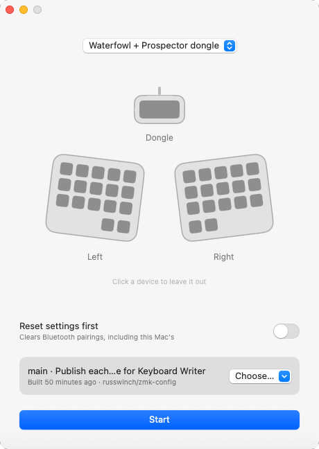
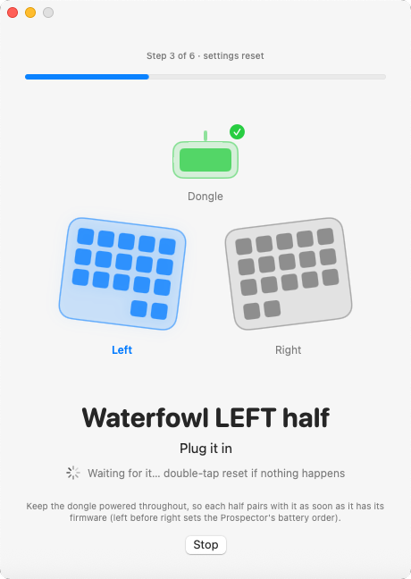
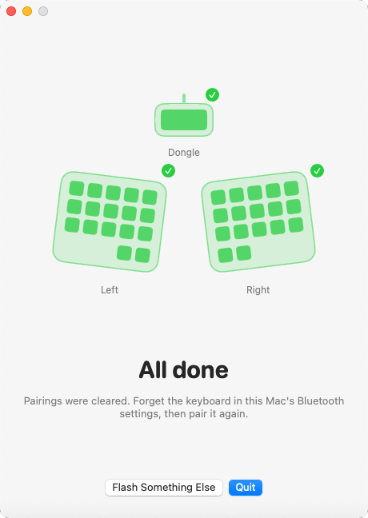

# Keyboard Writer

A small macOS app for flashing ZMK firmware onto a split keyboard (and its
dongle). Plug the devices in, press Start, and each one is flashed in order
with its own firmware. No double-tapping reset, no dragging files. It works
with ZMK only: other firmware such as QMK is not supported.

It has two halves:

- **The app** draws the keyboard, shows which device it is working on, and
  copies the right `.uf2` onto each device's bootloader drive.
- **A ZMK module** (`firmware/`) gives each device a USB serial port. Over it
  the device says which one it is, and starts its bootloader when the app asks.

A device whose firmware doesn't have the module yet (or is too broken to
answer) still works: double-tap reset and the app carries on from there.

<p>
  
  
  
</p>

## The app

```sh
./install.sh                       # the latest release, no build needed
./build.sh                         # or build it: needs Xcode or its command line tools
```

Either one puts `Keyboard Writer.app` into `/Applications`, so open it from
Spotlight, Launchpad or the Dock. Releases are tagged `v1.<n>`; the app's
About window shows which one is installed. When a newer release is out, an
"Update to 1.<n>" button at the top of the window installs it and reopens the
app, so `install.sh` is only needed the first time.

Pick the keyboard, click a device to leave it out, and press Start.

The firmware is the newest build of `main` in the config repo, fetched when
you press Start. "Choose…" lists the recent builds from every branch, and
also takes a zip or a folder of `.uf2` files from this Mac. With no builds to
offer (or no network) it uses the newest `firmware*.zip` in `~/Downloads`.
The button beside "Choose…" checks for builds published since the app opened.
See "Builds from the config repo" below for the config repo's side of this.

"Reset settings first" flashes `settings_reset` before each device's firmware,
which clears its Bluetooth pairings; each device is then done twice, so leave
it plugged in.

The app only sends a device into its bootloader if it says it is the one
wanted, and never copies onto a board of the wrong type.

### Keyboards

`targets.json` lists the keyboards: each device, the firmware file it takes
and its controller. The firmware name is the first shield of the build (or its
`artifact-name`), so keep it in step with the config repo's `build.yaml`.
Devices are flashed in the order listed.

### Builds from the config repo

The app reads the config repo's GitHub releases, which need no login. Each
release is one build: its name is what the list shows, its attached `.zip`
holds the `.uf2` files, and builds of branches other than `main` are marked
as prereleases.

The config repo publishes them with a `release` job after ZMK's own `build`
job; copy it from
[zmk-config's build.yml](https://github.com/russwinch/zmk-config/blob/main/.github/workflows/build.yml).

The app asks `russwinch/zmk-config`. To ask another repo:

```sh
defaults write com.github.russwinch.keyboard-writer repo owner/name
```

## The firmware module

In the ZMK config repo, add the module to `config/west.yml`:

```yaml
    - name: keyboard-writer
      url: https://github.com/russwinch/keyboard-writer
      revision: main
```

and give every build the serial port, in `config/default.overlay`:

```dts
#include <keyboard_writer.dtsi>
```

ZMK reads `default.overlay` only when `config/` has no overlay named after the
shield or board; if it has, put the include in that one.

That is all: `CONFIG_KEYBOARD_WRITER` is on by default once the port exists.
The module needs a board with the legacy Zephyr USB stack and retained boot
mode, which ZMK's `nice_nano` and `xiao_ble` have. It does nothing while the
board is off USB power.

How it works (`firmware/src/usb_trigger.c`): when the port is opened the
device writes `keyboard-writer <first shield>`, e.g.
`keyboard-writer waterfowl_left`; when the port is set to 1200 baud it reboots
into the bootloader.

## Development

`Sources/WriterCore` is plain Foundation and holds everything but the UI; it
builds and tests on Linux too (`swift test`). `Sources/KeyboardWriter` is the
SwiftUI app. The App workflow tests, builds, and runs the built app through a
full flash against pretend drives (`smoke.sh`), uploading screenshots.
